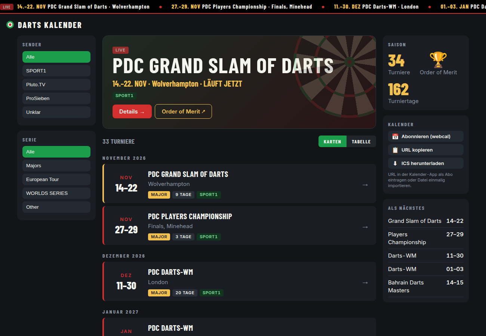
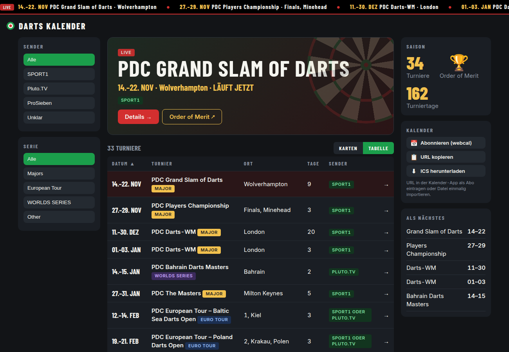

# 🎯 Darts Kalender

Ein schlanker Turnierkalender für die PDC-Saison — als Webseite, als JSON und als
abonnierbarer ICS-Kalender. Die Termine werden automatisch eingesammelt und täglich
neu aufgebaut.

## ✨ Funktionen

- 📅 **Karten- und Tabellenansicht** mit Umschalter
- 🔴 **Matchday-Status**: Turniertage, Countdown und "Als nächstes"-Liste
- 🎯 **Matchday-Spiele**: an Spieltagen die konkreten Paarungen des Tages
  (via [api.dartsapi.com](https://dartsapi.com/documentation))
- 🏷️ **Filter** nach Sender und Serie (Majors, European Tour, World Series …)
- 🏆 **Order of Merit** direkt verlinkt — aus der Saison-Karte und im Hero bei
  Majors und European-Tour-Events
- 📆 **ICS-Abo** (`webcal://`) inklusive Kopier- und Download-Button
- 📱 **Responsive** Layout mit Burger-Menü auf kleinen Bildschirmen
- 🚀 **Automatischer Build** per GitHub Action inklusive Deploy

## 🖼️ Screenshots

Kartenansicht:



Tabellenansicht:



## 📦 Ausgaben

| Datei        | Zweck                                   |
| ------------ | --------------------------------------- |
| `index.html` | Webseite mit eingebetteten Termindaten  |
| `darts.json` | Rohdaten als JSON                       |
| `darts.ics`  | Kalender zum Abonnieren oder Importieren |
| `fixtures.json` | Matchday-Spiele des Tages als JSON   |

## 🛠️ Nutzung

```bash
python3 -m venv .venv      # optional, nur Standardbibliothek nötig
./run.sh
```

Das Zielverzeichnis ist standardmässig `dist/` und lässt sich über die
Umgebungsvariable `OUT_DIR` überschreiben:

```bash
OUT_DIR=/pfad/zum/ziel ./run.sh
```

Alternativ kann eine lokale `.env` im Projektverzeichnis angelegt werden;
`run.sh` lädt sie automatisch. Eine explizit gesetzte Umgebungsvariable hat
Vorrang vor der `.env`. Vorlage: [`.env.example`](.env.example) — die `.env`
selbst ist per `.gitignore` ausgeschlossen.

```bash
cp .env.example .env
```

Alternativ direkt:

```bash
python3 fetch_termine.py --out-dir dist --html-out dist/index.html
```

Optionen wie `--source`, `--et-source` oder `--layout` erlaubt die Arbeit mit
lokalen Kopien; ein Blick in `--help` lohnt sich.

## 🎯 Matchday-Spiele

An Spieltagen werden zusätzlich die konkreten Paarungen des Tages aus
[api.dartsapi.com](https://dartsapi.com/documentation) geladen und unter dem
Hero angezeigt. Dafür wird der API-Key in der Umgebungsvariable
`DARTS_API_KEY` erwartet:

```bash
DARTS_API_KEY="da_live_..." ./run.sh
```

Ohne Key oder bei API-Fehlern läuft der Build normal weiter, es werden nur
keine Spiele eingeblendet. Für Tests gibt es `--fixtures-source <datei.json>`
(lokale API-Antwort) und `--no-fixtures`. Der kostenlose Tarif erlaubt 60
Anfragen pro Minute bzw. 500 pro Tag.

## 🗂️ Aufbau

- `fetch_termine.py` — Abruf, Aufbereitung, JSON- und ICS-Erzeugung
- `layout.html` — Template der Webseite, wird mit den Termindaten befüllt
- `blacklist.txt` — Einträge, die nicht übernommen werden
- `run.sh` — Build-Skript für den täglichen Lauf
- `.github/` — Workflow für Build und Deploy

## ⚠️ Hinweis

Die Termine werden automatisch übernommen und ohne Gewähr bereitgestellt.
Terminverschiebungen der Veranstalter sind jederzeit möglich.

## 🤖 Robots.txt

Vor jedem Abruf wird die `robots.txt` des Ziel-Hosts ausgewertet (RFC 9309).
Geprüft werden sowohl die passende `User-agent`-Gruppe (Produkt-Token
`darts-calender`, sonst `*`) als auch der Pfad inklusive Wildcards (`*`, `$`)
und Longest-Match. Auch Weiterleitungsziele werden geprüft.

- `4xx` auf `robots.txt`: Zugriff auf den Host gilt als erlaubt.
- `5xx`, Timeout oder Netzwerkfehler: Der Lauf bricht mit Fehlercode und
  Meldung ab (RFC: „unreachable“ = komplett gesperrt).
- Gesperrte URL: Abbruch mit klarer Fehlermeldung, kein Deploy.

## License

Licensed under the [MIT License](LICENSE) - Copyright (c) 2026 Stefan Koelle (https://stefankoelle.de)
